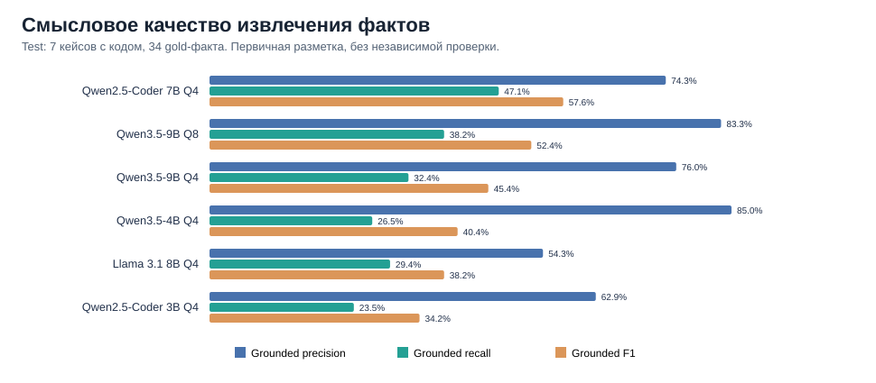
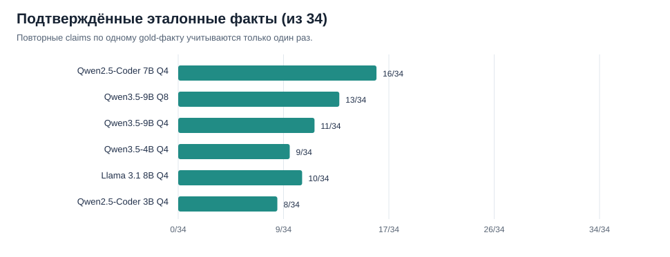
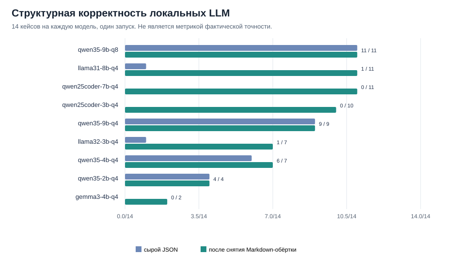
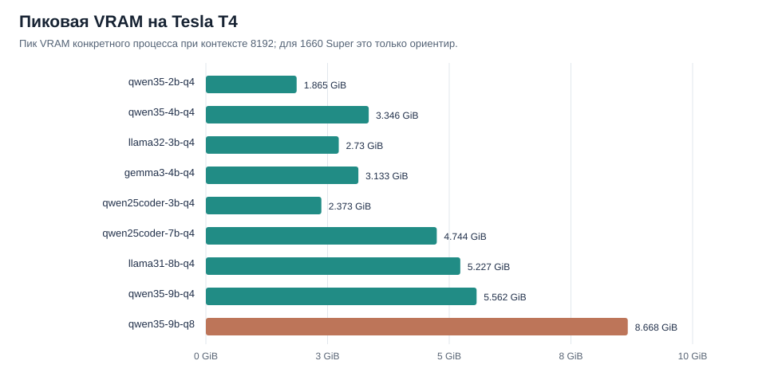

# Repo Analyzer: сравнение локальных LLM (benchmark v8)

> **Статус:** предварительное экспериментальное сравнение. Дата запуска: **12 октября 2026** · Run ID: `20261012T160658Z` · Tesla T4 · контекст 8192 токена · один прогон. Семантические метки не проходили независимую повторную проверку.

## Задача эксперимента

Выбрать модель для **извлечения технических фактов из исходного кода GitHub-репозиториев** в формате `RepoEvidence` со ссылками на файлы и строки. Это **не** оценка авторства коммитов, генерации резюме или качества формулировок CV: происхождение изменений и написание резюме относятся к отдельным стадиям пайплайна.

Проверяются три аспекта: **структура** (JSON/schema/source locators), **смысловая обоснованность** (Grounded Precision/Recall/F1) и **ресурсы** (VRAM/время). Все локальные модели запускались **на Tesla T4**, в том числе модели, рассматриваемые для GTX 1660 Super 6 GB. Результаты 1660 Super по времени и совместимости здесь **не измерялись**.

## Основные результаты: качество на test

Семантическая оценка — **7 кейсов с исходным кодом** из 4 test-репозиториев, **34 заранее выбранных эталонных факта (gold)**. Один дополнительный test-кейс содержал только README и исключён из метрик *implementation evidence*. Сохранены **210 размеченных утверждений** (180 в code test, ещё 30 в documentation-only).

| Локальная модель | Grounded Precision | Grounded Recall | Grounded F1 | Gold с доказательством | Claims по коду | Неразбираемых ответов | Пик VRAM на T4 |
|---|---:|---:|---:|---:|---:|---:|---:|
| **Qwen2.5-Coder 7B Q4** | 74.3% | 47.1% | **57.6%** | 16/34 | 35 | 0/7 | 4.74 GiB |
| **Qwen3.5-9B Q8** | 83.3% | 38.2% | **52.4%** | 13/34 | 30 | 1/7 | 8.67 GiB |
| Qwen3.5-9B Q4 | 76.0% | 32.4% | 45.4% | 11/34 | 25 | 2/7 | 5.56 GiB |
| Qwen3.5-4B Q4 | 85.0% | 26.5% | 40.4% | 9/34 | 20 | 3/7 | 3.35 GiB |
| Llama 3.1 8B Q4 | 54.3% | 29.4% | 38.2% | 10/34 | 35 | 0/7 | 5.23 GiB |
| Qwen2.5-Coder 3B Q4 | 62.9% | 23.5% | 34.2% | 8/34 | 35 | 0/7 | 2.37 GiB |





**Что означают цифры?** Grounded claim — истинное техническое утверждение, подтверждённое **именно указанными** строками исходника. Grounded Precision = число таких claims / все разобранные claims по коду. Grounded Recall = число уникальных gold-фактов, найденных с корректным evidence / 34; повтор одного факта recall не увеличивает. Grounded F1 — гармоническое среднее. «Не разобрано» — число случаев с невалидным JSON даже после удаления внешнего Markdown fence. Подробные определения — в [METHODOLOGY.md](METHODOLOGY.md).

**Основное наблюдение:** Coder 7B Q4 покрывает больше выбранных эталонных фактов, Qwen3.5-9B Q8 выдаёт более высокую долю claims с прямым доказательством. Разница F1 **5.2 п.п.** не доказывает превосходство при одной выборке и одном прогоне.

## Структурная надёжность: все локальные конфигурации

На 14 кейсах из 8 публичных GitHub-репозиториев проверялись ещё и формальная JSON/schema-валидность и соответствие диапазонов номеров строк. **Эта метрика не проверяет фактическую истинность claims.**



| Модель | Сырой структурный pass | После снятия внешних `\`\`\`json` |
|---|---:|---:|
| Qwen3.5-9B Q8 | 11/14 | 11/14 |
| Llama 3.1 8B Q4 | 1/14 | 11/14 |
| Qwen2.5-Coder 7B Q4 | 0/14 | 11/14 |
| Qwen2.5-Coder 3B Q4 | 0/14 | 10/14 |
| Qwen3.5-9B Q4 | 9/14 | 9/14 |
| Llama 3.2 3B Q4 | 1/14 | 7/14 |
| Qwen3.5-4B Q4 | 6/14 | 7/14 |
| Qwen3.5-2B Q4 | 4/14 | 4/14 |
| Gemma 3 4B Q4 | 0/14 | 2/14 |
| Phi-4-mini Q4 | загрузка не удалась | — |

При нормализации убирается **только** внешняя Markdown-обёртка; недостающие фигурные скобки, неправильные поля и неверные локаторы **не исправляются**. Поэтому показатели до и после нормализации показываются раздельно.

## VRAM и выбор аппаратного сценария



Измерен **пик VRAM процесса `llama-server`** при контексте 8192, с проверкой полной выгрузки слоёв на GPU. Размер GGUF на диске не равен пику VRAM. T4 использовалась и для оценки вместимости моделей в **6 GiB**; этот прогноз не равен запуску на 1660 Super.

Предварительные кандидаты:
- **Под 6 GiB:** Qwen2.5-Coder 7B Q4 (4.74 GiB на T4), запасные — Qwen3.5-4B Q4 и Qwen2.5-Coder 3B Q4. Достаточность VRAM на GTX 1660 Super требует отдельного подтверждения.
- **Под T4 16 GB:** Qwen3.5-9B Q8 (8.67 GiB на T4) и Coder 7B Q4 как контрольная альтернатива.

## Датасет

Split сделан **по репозиториям**, не по фрагментам одного проекта.

| Split | Репозитории | Кейсов |
|---|---|---:|
| dev | [vlm-nutrition-analyzer](https://github.com/Ferraronp/vlm-nutrition-analyzer), [rag_mtuci](https://github.com/Ferraronp/rag_mtuci), [github2CV_ML](https://github.com/Ferraronp/github2CV_ML) | 6 |
| test | [military-charters-rag](https://github.com/Ferraronp/military-charters-rag), [gpt-pretrain](https://github.com/Ferraronp/gpt-pretrain), [reasoning-memory](https://github.com/Ferraronp/reasoning-memory), [llm.c_tensorboard](https://github.com/Ferraronp/llm.c_tensorboard), [CosyVoice-gguf-converter](https://github.com/Ferraronp/CosyVoice-gguf-converter) | 8 |

`tensorboard-adapter` — имя кейса из **llm.c_tensorboard**, адаптирующего логи обучения к TensorBoard; это не отдельная LLM. `sparse-converter` — README-only кейс из **CosyVoice-gguf-converter**; наличие документации не доказывает реализацию.

Каждый frozen snapshot был собран с конкретного commit SHA. Соответствие gold-фактов commit SHA / файлам / строкам содержится в [annotations/gold_facts_ai.csv](annotations/gold_facts_ai.csv).

## Протокол и воспроизводимость

- **Точный prompt, ожидаемая JSON Schema, формат передачи кода и параметры генерации:** [PROMPT_AND_SCHEMA.md](PROMPT_AND_SCHEMA.md).
- **Метрики, знаменатели, критерии разметки и ограничения:** [METHODOLOGY.md](METHODOLOGY.md).
- **Табличные результаты:** [data/](data/), [заполненные аннотации](annotations/claims_test_ai_annotated.csv) и [gold](annotations/gold_facts_ai.csv). Исходные поля provenance в таблицах сохранены.
- **Colab эксперимент:** [notebooks/colab_benchmark_v8.ipynb](notebooks/colab_benchmark_v8.ipynb).
- **Пересчёт quality из таблиц:** `python scripts/recompute_semantic.py` (без обращения к моделям и API).

**Ограничения:** небольшая намеренно выбранная gold-выборка, один прогон, отсутствие независимой проверки семантических меток, отсутствие blind review и измерений на GTX 1660 Super. Coverage измеряет **выбранные 34 факта**, а не полноту всех возможных свойств проектов. Семантический анализ не оценивает личный вклад автора и качество готового CV.

Облачные API были частью технического прогона, но большинство запросов к Groq ограничены HTTP 429; **API не включаются в первичный рейтинг локальных моделей**, повторного API-эксперимента не было.


## Аудит первичного прогона и ограничения

**Первичный архив `benchmark_20261012T160658Z.zip` не размещён в данном PR.**
Включённые CSV позволяют пересчитать смысловую оценку, но сами по себе **не позволяют независимо верифицировать структурный pass rate, VRAM, исходные raw predictions и границы numbered snippets**. Не следует считать эти показатели полностью аудируемыми только по GitHub-файлам.

В [RUN_PROVENANCE.md](RUN_PROVENANCE.md) сохранены SHA-256 исходного ZIP и всех пяти внутренних файлов, фактические настройки полного запуска, список commit SHA публичных репозиториев и способ проверки подлинности. Опубликованный Colab-ноутбук по умолчанию использует **smoke-конфигурацию**; фактически 12 октября выполнялся **полный набор из 14 кейсов**. Если исходный ZIP доступен, выполнить независимый пересчёт структурных результатов и сравнение VRAM можно без GPU и API:

```bash
cd experiments/repo_analyzer/2026-10-12-v8
python scripts/verify_raw_archive.py /path/to/benchmark_20261012T160658Z.zip
```

При подготовке этого исправления такой пересчёт **по оригинальному архиву** сошёлся с исправленными таблицами: 168 raw predictions, 196 попыток, 14 кейсов, корректное разделение Gemma/Phi. Однако **для полного публичного аудита** оригинальный архив необходимо отдельно опубликовать по неизменяемому URL и сверить по приведённому SHA-256.

CSV-структура всех агрегатов дополнительно проверяется автоматическим тестом `tests/test_benchmark_report_csv.py` при запуске CI.
